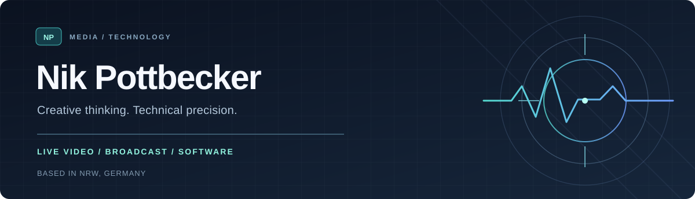

  

  <strong>Filmmaker &nbsp;·&nbsp; Live Video Technician &nbsp;·&nbsp; Developer</strong> 
  Working at the intersection of media, technology and storytelling.

  <a href="https://nikpottbecker.de"><strong>Portfolio &amp; Website</strong></a>

---

### About

I combine hands-on video production with software development and technical problem-solving. I'm particularly interested in the systems behind live broadcasts — from cameras and transmission to control rooms, automation and reliable delivery.

My approach is to make complex technology **practical, dependable and easy to use**.

### Areas of focus

**01 &nbsp; Live production & broadcast**  
Live video workflows, IRL streaming, production systems, contribution feeds and real-time transport.

**02 &nbsp; Software & automation**  
Tools and integrations that simplify repetitive work, connect systems and make production workflows more efficient.

**03 &nbsp; Film & photography**  
Visual storytelling, camera work and motorsport media — with a focus on both the creative and technical sides.

### Tools & technologies

`OBS Studio` &nbsp; `vMix` &nbsp; `SRT / NDI` &nbsp; `FFmpeg`  
`TypeScript / Node.js` &nbsp; `Python` &nbsp; `Linux` &nbsp; `Proxmox` &nbsp; `Cloudflare`

### Background

I've gained practical insight into professional broadcast environments through placements at **RTL Deutschland** and **Studio Berlin**, alongside my work in video production and motorsport photography.

---

  <strong>Good media technology should be reliable behind the scenes — and effortless to use in the moment.</strong> 
  Find out more or get in touch via <a href="https://nikpottbecker.de">nikpottbecker.de</a>.

